  

Second-year Computer Engineering student at the **Universitat Politècnica de València**. I work on the **avionics** of a fixed-wing UAV team (sensors, autopilot, power, telemetry) and build software on the side, usually pairing with an AI agent and keeping what actually works.

### Things I've built

| | Project | What it is |
|---|---|---|
| 🕹️ | [**ascii-arcade**](https://github.com/rrc-898/ascii-arcade) | Twelve classic games drawn with nothing but ASCII on a 64×32 text screen. Plain HTML/CSS/JS. [**Play it →**](https://rrc-898.github.io/ascii-arcade/) |
| ✈️ | [**uav-design-suite**](https://github.com/rrc-898/uav-design-suite) | Engineering platform to design, simulate and optimise UAVs: propulsion, mission and CFD modules, plus a full XtraChallenge 2027 package. Astro + TypeScript. |
| 🎬 | [**animaciones-explicativas**](https://github.com/rrc-898/animaciones-explicativas) | Narrated study videos generated entirely from code: a JS script, local TTS (Kokoro), word-level alignment (Whisper) and a Canvas 2D engine. |
| 🧊 | [**claude-blender**](https://github.com/rrc-898/claude-blender) | Add-on + CLI that lets an AI agent inspect and edit the *live* Blender session, with undo. |
| 🎞️ | [**claude-resolve**](https://github.com/rrc-898/claude-resolve) | The same idea for DaVinci Resolve Studio, through its scripting API. |
| 🚀 | [**Aura**](https://github.com/rrc-898/Aura) | Productivity launcher inspired by GNOME Shell, macOS and the Nintendo 3DS. |

### Day to day

`TypeScript` `Python` `C` `JavaScript` `Astro` `LaTeX / Typst` · Fedora + Hyprland · Blender · DaVinci Resolve

Spanish native · learning English and French.
