  

I'm **Ricardo Roig Constantin**, a second-year Computer Engineering student at the **Universitat Politècnica de València**. I work on the **avionics** of a fixed-wing UAV team (sensors, autopilot, power, telemetry) and build software on the side, usually pairing with an AI agent and keeping what actually works.

  <a href="https://rrc-898.github.io"><b>Website</b></a> ·
  <a href="https://www.linkedin.com/in/ricardo-roig-constantin-04709938a/"><b>LinkedIn</b></a> ·
  Valencia, Spain

### Aerospace & UAV

| Project | What it is |
|---|---|
| [**uav-design-suite**](https://github.com/rrc-898/uav-design-suite) | Engineering platform to design, simulate and optimise fixed-wing UAVs: propulsion, mission and aerodynamics modules, plus a full Xtra Challenge 2027 package. Astro + TypeScript. |
| [**xc27-propeller-analysis**](https://github.com/rrc-898/xc27-propeller-analysis) | Propeller characterisation from in-motion thrust-bench PX4 logs: thrust vs airspeed, RPM from the IMU spectrum, Ct/Cp vs advance ratio and motor–propeller torque balance. Python + Qt. |
| [**cortahilo-Xtra2**](https://github.com/rrc-898/cortahilo-Xtra2) | Marlin firmware configured for the team's CNC hot-wire foam cutter. |

### Hardware & Linux

| Project | What it is |
|---|---|
| [**wiipad**](https://github.com/rrc-898/wiipad) | A Wii Remote as a native Linux controller: Xbox 360 pad, mouse or keyboard via `uinput`, Nunchuk, rumble, profiles and DSU gyro aiming for Dolphin. Pure Python. |
| [**gestpad**](https://github.com/rrc-898/gestpad) | Hands-free computer control from a webcam: hand and face gestures to mouse and keyboard with MediaPipe, Wayland-ready. |
| [**2ds-remote**](https://github.com/rrc-898/2ds-remote) | Drive a Nintendo 2DS running Luma3DS from a PC: input injection, screen capture and a containerised devkitPro toolchain. |
| [**pupitre**](https://github.com/rrc-898/pupitre) | Focused PDF and slide reader for studying, with per-file memory and non-destructive annotations. GTK4 + Poppler. |
| [**vpn-upv**](https://github.com/rrc-898/vpn-upv) | One-command setup of the UPV university VPN on any Linux distro (strongSwan IKEv2). |
| [**dotfiles**](https://github.com/rrc-898/dotfiles/tree/fedora) | My Fedora port of a Hyprland + Quickshell desktop. |

### AI-assisted tools

| Project | What it is |
|---|---|
| [**editor-autonomo**](https://github.com/rrc-898/editor-autonomo) | Claude Code + DaVinci Resolve (free and Studio) for autonomous video editing, with a packaged skill and cloud footage download. |
| [**claude-blender**](https://github.com/rrc-898/claude-blender) | Add-on + CLI that lets an AI agent inspect and edit the *live* Blender session, with undo. |
| [**animaciones-explicativas**](https://github.com/rrc-898/animaciones-explicativas) | Narrated study videos generated from code: JS script, local TTS (Kokoro), Whisper alignment and a Canvas 2D engine. |

### Small things

| Project | What it is |
|---|---|
| [**ascii-arcade**](https://github.com/rrc-898/ascii-arcade) | Twelve classic games drawn only with ASCII. [Play it →](https://rrc-898.github.io/ascii-arcade/) |
| [**pomodoro**](https://github.com/rrc-898/pomodoro) | Terminal Pomodoro timer with big ASCII digits. |
| [**Aura**](https://github.com/rrc-898/Aura) | Productivity launcher inspired by GNOME Shell, macOS and the Nintendo 3DS. PWA + Android. |

### Day to day

`Python` `TypeScript` `JavaScript` `C / C++` `Java` `Haskell` `Astro` `Qt / GTK4` `LaTeX / Typst` · PX4 · Linux internals (`uinput`, udev, BlueZ) · Blender · DaVinci Resolve

Spanish native · learning English and French.
